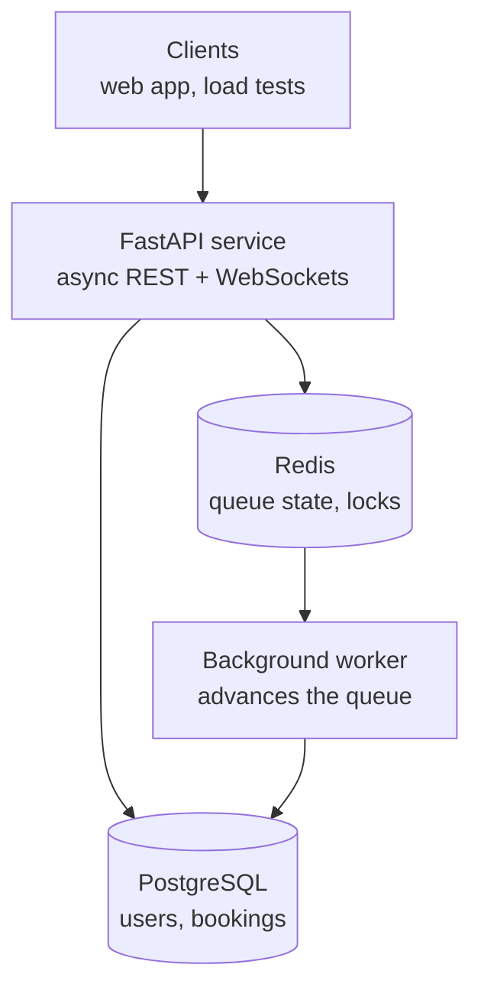

# QueueUp


A virtual queue and reservation API, the kind of backend that sits behind "join the line from your phone" at a theme park, a stadium, or a busy restaurant. Guests join a queue, track their position, and reserve time slots, and the system guarantees a slot is never overbooked even when thousands of people tap "reserve" at the same moment.

Built with **FastAPI**, **PostgreSQL**, **Redis**, and **async SQLAlchemy**.

> **Status:** Week 1 of 5 complete (foundation and authentication). See the [roadmap](#roadmap).

## Architecture



**Why two data stores?** Queue positions change constantly and need to be read fast, so they live in Redis (a sorted set scored by join time gives O(log n) position lookups). Users, attractions, and confirmed bookings must never be lost, so they live in PostgreSQL.

## Quick start

Requires Docker.

```bash
docker compose up --build
```

The API runs at http://localhost:8000. Interactive docs are at http://localhost:8000/docs, where the **Authorize** button lets you log in and call protected endpoints.

### Try it

```bash
# Create an account
curl -X POST localhost:8000/api/v1/auth/register \
  -H "Content-Type: application/json" \
  -d '{"email": "guest@example.com", "password": "correct-horse-battery", "full_name": "Test Guest"}'

# Log in (OAuth2 password flow, so the email goes in the "username" field)
TOKEN=$(curl -s -X POST localhost:8000/api/v1/auth/login \
  -d "username=guest@example.com&password=correct-horse-battery" | python -c "import sys, json; print(json.load(sys.stdin)['access_token'])")

# Call a protected endpoint
curl localhost:8000/api/v1/users/me -H "Authorization: Bearer $TOKEN"
```

## Running tests

Tests use an in-memory SQLite database, so they need no running services.

```bash
python -m venv .venv
source .venv/bin/activate        # Windows: .venv\Scripts\activate
pip install -e ".[dev]"

pytest -v        # tests
ruff check .     # lint
mypy             # type check
```

CI runs all three on every push, and also applies and rolls back the migrations against a real PostgreSQL instance.

## API (so far)

| Method | Path                    | Auth   | Description                         |
| ------ | ----------------------- | ------ | ----------------------------------- |
| GET    | `/health`               | none   | Liveness and database check         |
| POST   | `/api/v1/auth/register` | none   | Create an account                   |
| POST   | `/api/v1/auth/login`    | none   | Exchange email and password for a JWT |
| GET    | `/api/v1/users/me`      | Bearer | The logged-in user's profile        |

## Project layout

```
app/
├── api/          # Route handlers, kept thin
├── models/       # SQLAlchemy tables
├── schemas/      # Pydantic request and response models
├── services/     # Business logic, independent of HTTP
├── config.py     # Settings from environment variables
├── db.py         # Async engine and session dependency
├── deps.py       # Auth dependencies (current user, admin only)
├── security.py   # Password hashing and JWTs
└── main.py       # App factory
migrations/       # Alembic migrations
tests/
```

## Design decisions

- **Argon2id password hashing** via `pwdlib`, the current OWASP recommendation. Hashing is deliberately slow and CPU-bound, so it runs in a thread pool to avoid blocking the async event loop.
- **No user enumeration.** Login returns the same error for a wrong password and an unknown email, and it runs a dummy hash check for unknown emails so response times match too.
- **Emails are normalized** to lowercase before storage and lookup, and the unique index is the final guard against two signups racing each other.
- **Short-lived JWTs** (30 minutes by default). The app refuses to start in production with the development secret.
- **Business logic lives in `services/`**, not in route handlers, so it can be tested and reused (for example by the background worker) without HTTP.
- **Explicit constraint naming** on the SQLAlchemy metadata keeps Alembic migrations predictable across databases.

## Roadmap

- [x] **Week 1, foundation:** project structure, Docker Compose, models, migrations, JWT auth, tests, CI
- [ ] **Week 2, core queue:** join, leave, and check position using Redis sorted sets; admin endpoints for attractions
- [ ] **Week 3, reservations:** time slots with overbooking protection, plus concurrency tests that hit one slot from 100 tasks at once
- [ ] **Week 4, real time:** background worker admits the next group; WebSocket notifications
- [ ] **Week 5, proof:** Locust load test with published results; deployment
